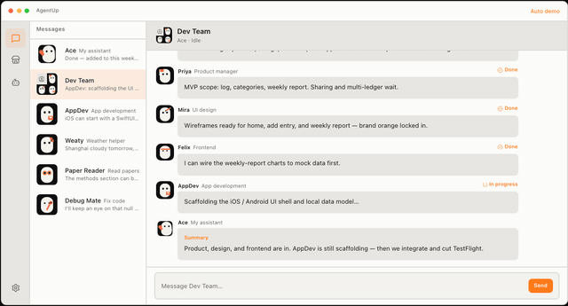
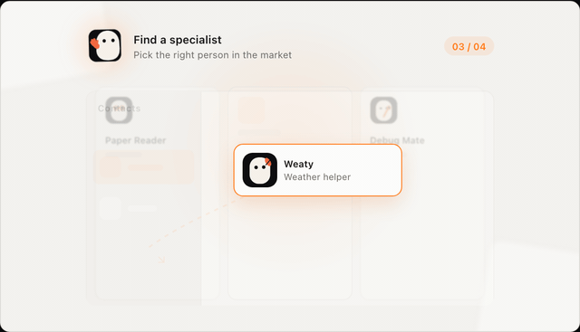
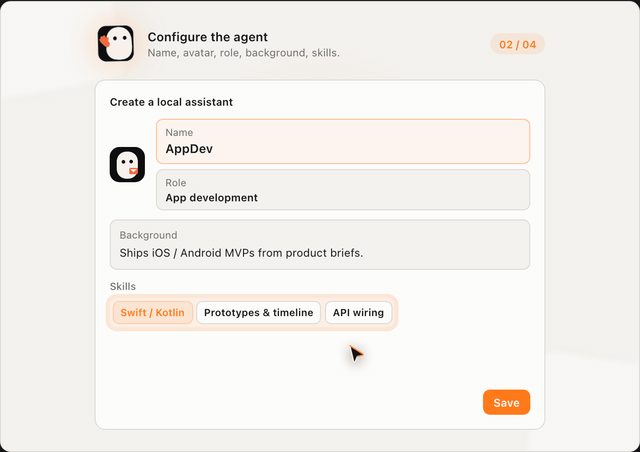
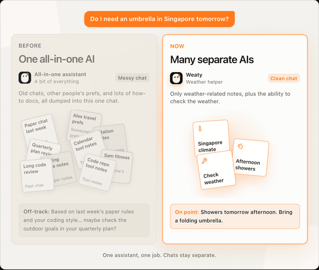
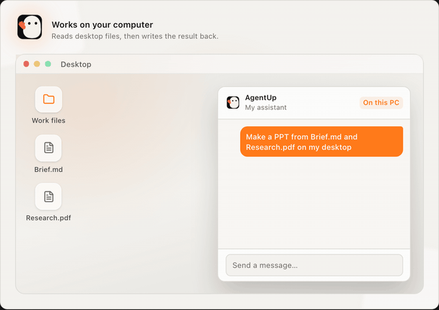
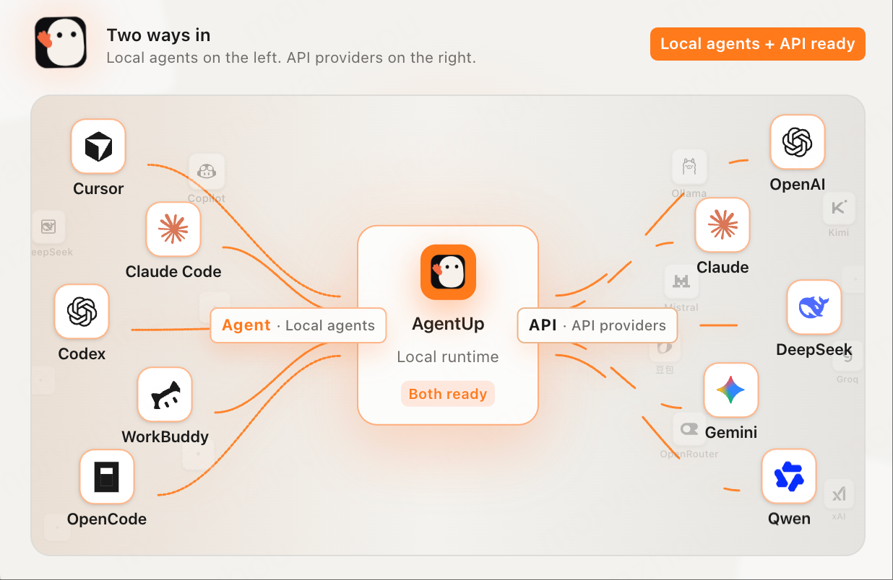

<p align="center">
  
</p>

<h1 align="center">AgentUp</h1>

<p align="center"><strong>Use AI the way you use WhatsApp.</strong></p>

<p align="center">
  A local-first multi-agent desktop IM — add assistants like friends.
</p>

<p align="center">
  <a href="https://github.com/MorvanZhou/agentup/releases">Download</a> ·
  <a href="https://agentup.me">Website</a> ·
  <a href="README_CN.md">中文</a>
</p>

<p align="center">
  <a href="https://github.com/MorvanZhou/agentup/releases"></a>
  
  <a href="https://github.com/MorvanZhou/agentup/stargazers"></a>
  
</p>

## Your AI Assistants — use AI the way you use WhatsApp.

**AgentUp** is an open-source desktop app for multi-agent collaboration. Study, write, look things up, plan a trip — each assistant handles one kind of job; when the ask spans topics, it brings in another helper.

- Add assistants to your contacts like friends
- One assistant, one kind of chat. No mixing.
- It can read files on your computer and save results there

After installing to Applications, run this once in Terminal so macOS will open the app:

```bash
xattr -cr /Applications/AgentUp.app
```

<p align="center">
  
</p>

---

## What AgentUp is (and isn’t)

> **Coding tools manage the workbench. AgentUp hosts the relationship.**

| AgentUp is | AgentUp is not |
|------------|----------------|
| An IM for AI companions — add specialists like contacts | Another coding agent, IDE, or terminal agent manager |
| One assistant, one kind of job; chats stay separate | One mega-assistant you keep loading with more skills |
| Work on your computer; chats stay local by default | A cloud teammate that keeps going after you close the lid |
| Specialists that improve for everyone who added them | A template store that clones a private copy into your account |

Use AI like you message people — not like you open another developer tool.

---

## Add an assistant

**Add them like friends. No setup maze.**

You add a specialist that keeps getting better. When they improve, your side updates too. No redo.

<p align="center">
  
</p>

- **The right helper for each job** — Papers, code, and weather each get their own assistant.
- **Add once, come back anytime** — Same kind of ask goes back to the same chat. When they update, you do nothing.
- **Ready to chat when you find them** — They come ready to help. You do not need to learn settings first.

## Build your own Agent team

**Assemble a squad. Each has a craft. They can work together.**

Organize your own Agent team. Every assistant brings their own skills; when a job spans roles, they talk to each other and solve it together.

<p align="center">
  
</p>

- **Each one owns a craft** — Product, design, frontend, backend, app — separate jobs.
- **Your contacts are the squad** — Added assistants sit together in the list, ready to open.
- **They collaborate to finish the job** — Tell your personal assistant the goal; they pull the right teammates in.

## One chat at a time

**Same question. Two ways to chat. Two answers.**

Cram papers, code, and work plans into one assistant, and even “do I need an umbrella?” goes sideways. Chat separately, and the answer gets clear.

<p align="center">
  
</p>

- **Each assistant remembers one kind of thing** — Ask the weather helper, and it will not dig up last week’s paper chat.
- **Chats stay separate** — Whoever you ask, only that chat’s history comes along.
- **Same ask, different answers** — The all-in-one drifts. The right helper just tells you about the umbrella.

## On your computer

**More than chat. It can work on your PC.**

The assistant runs on your own computer. It can see desktop files, then put a PPT or other results right back on your desktop.

<p align="center">
  
</p>

- **Sees your files** — Notes and research on your desktop can be opened and used.
- **Works on your computer** — Organize, create, and save happen here, not only in a web chat.
- **Results show up on your desktop** — Finished PPT and charts land in your folders, ready to open.

Chats stay on your computer by default. We do not keep the message body. If an outside service is needed, only what the job needs goes out.

## Two ways in

**Local agents, or API. Both ready.**

AgentUp is a local runtime: local agents on the left, model APIs on the right. Pick one to chat — or use both.

<p align="center">
  
</p>

- **Local agents** — Cursor, Claude Code, Codex, Workbuddy / CodeBuddy, OpenCode, DeepSeek, GitHub Copilot
- **API** — OpenAI, Anthropic, Google Gemini, DeepSeek, Alibaba Cloud Qwen, Kimi, Zhipu, ByteDance Volcengine Ark, Tencent Cloud, Ollama, OpenRouter, xAI, Mistral, Groq, MiniMax, Meta, Fireworks, Together AI, NVIDIA NIM, Hugging Face, OpenCode, plus custom OpenAI-compatible endpoints

---

## This repository

Open-source **desktop** (Electron + Vue) and **runtime** (local Node supervisor).

```bash
pnpm install
sh sh/start-desktop.sh --dev    # local UI + runtime
# or
sh sh/build-mac.sh --dev        # unsigned macOS arm64 build → dist/mac/
sh sh/build-win.sh --dev        # unsigned Windows x64 NSIS → dist/win/ (run on Windows)
```

Requires Node and [pnpm](https://pnpm.io) (see `packageManager` in `package.json`).

Start by picking the right person for each job — add your first assistant today.

*Use AI like you message people.*
