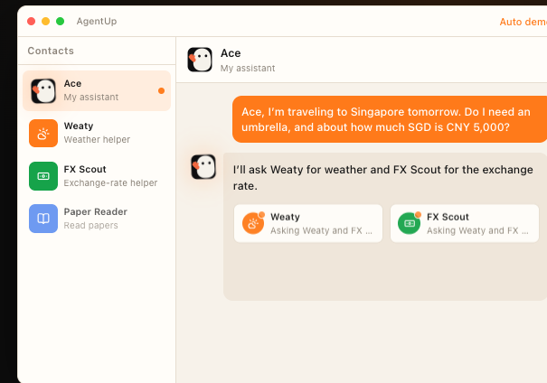
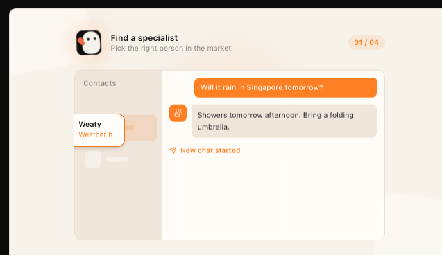
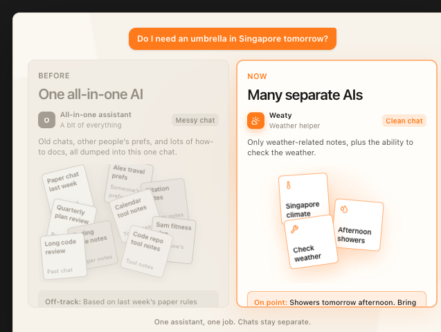
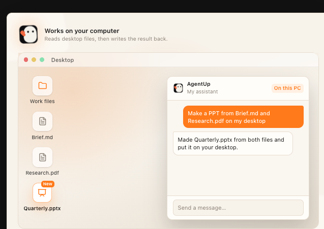

<p align="center">
  
</p>

# AgentUp

[English](README.md)

**你的 AI 伙伴 — 像用 WhatsApp 一样用 AI。**

学习、写东西、查资料、规划出行。每个助手只做一类事。问题跨了好几个主题，它会再叫一个帮手来。

- 像加朋友一样，把助手加进通讯录
- 一个助手，一种聊天。互不掺和。
- 能读你电脑上的文件，并把结果存回去

**[下载 Mac 版](https://downloads.agentup.me/desktop/mac/latest/AgentUp-arm64.dmg)** · **[agentup.me](https://agentup.me)**

安装到「应用程序」后，在终端执行一次下面的命令，才能正常打开：

```bash
xattr -cr /Applications/AgentUp.app
```

<p align="center">
  
</p>

---

## 添加助手

**像加朋友一样添加。不用先钻进一堆设置。**

你加的是一个会持续变好的专家。他们变好了，你这边也会跟着更新。不用重来。

<p align="center">
  
</p>

- **每件事找对帮手** — 论文、代码、天气，各有各的助手。
- **加一次，随时回来** — 同类问题回到同一个聊天。他们更新时，你什么都不用做。
- **找到就能聊** — 他们准备好了就能帮你。不用先学设置。

## 一次只聊一个

**同一个问题。两种聊法。两个答案。**

把论文、代码、工作计划塞进同一个助手，连「今天要不要带伞」都会跑偏。分开聊，答案就清楚了。

<p align="center">
  
</p>

- **每个助手只记一类事** — 问天气助手，它不会翻出上周聊论文的记录。
- **聊天各管各的** — 你问谁，就只带上那个聊天的历史。
- **同样的问题，不同的答案** — 什么都管的那个会跑偏。对的帮手只告诉你伞的事。

## 就在你的电脑上

**不只是聊天。它能在你的电脑上干活。**

助手跑在你自己的电脑上。它能看到桌面上的文件，再把 PPT 或其他结果放回桌面。

<p align="center">
  
</p>

- **看得到你的文件** — 桌面上的笔记和资料可以直接打开使用。
- **在你的电脑上干活** — 整理、创建、保存都在这里完成，不只停在网页聊天里。
- **结果出现在桌面上** — 做好的 PPT 和图表落到你的文件夹里，打开就能用。

聊天默认留在你的电脑上。我们不保存消息正文。如果需要外部服务，只发出完成这件事所必需的内容。

---

## 本仓库

开源的 **桌面端**（Electron + Vue）和 **运行时**（本地 Node 监督进程）。

```bash
pnpm install
sh sh/start-desktop.sh --dev    # 本地界面 + 运行时
# 或
sh sh/build-mac.sh --dev        # 未签名的 macOS arm64 构建 → dist/mac/
```

需要 Node 和 [pnpm](https://pnpm.io)（见 `package.json` 里的 `packageManager`）。

先给每件事找对人 — 今天就添加你的第一个助手。

*像给朋友发消息一样使用 AI。*
